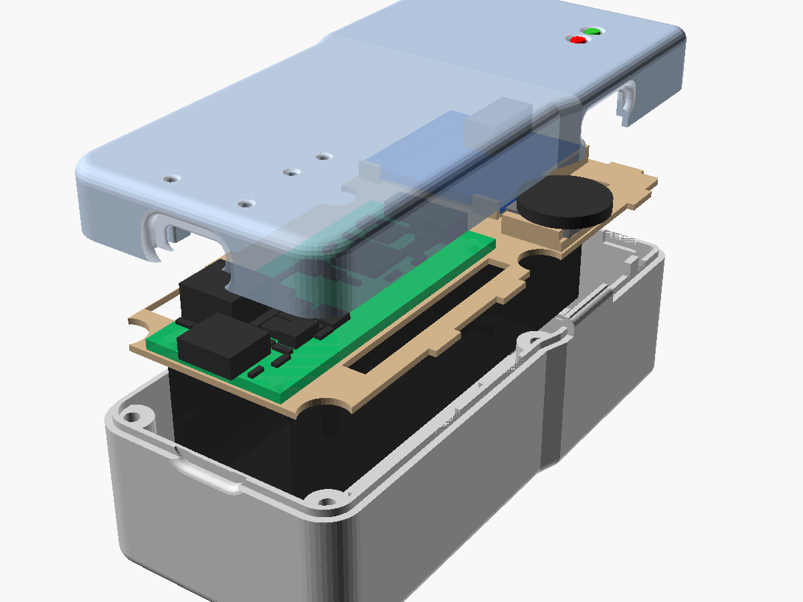

# OpenALD Feather RP2040 v1.0

This is a variant of the OpenALD pocket FM radio built around an **Adafruit Feather RP2040**. It has:
* an RDA5807M FM module with its own 3.5 mm jack,
* an 18650 cell in an MPD BH-18650-PC holder (the same holder as the single-board radio),
* a **Mitsumi SIQ-02FVS3 thumbwheel** (volume/tune + push), bought loose and **glued into a printed cradle** on the frame,
* an **SS-12F16 slide switch** (SPDT, "G4" 4 mm knob by default) **pressed into a groove in the case wall, no screws**,
* hand-soldered wires from the wheel and the switch to the Feather. **There is no custom PCB** in this variant.
* a thin 3D-printed **internal frame** that locates everything and is **clamped between the two case halves** at the parting line.

The bottom 2 in of the case is a copy of the single-board radio's case, so it fits the same **OpenALD charging dock**.

> **Status: design only. Nothing here has been printed, built or tested.**
> - The FM-module mounting-hole and jack positions are **estimates**. The module photo could not be measured. See "Measure and edit" below.
> - Feather part heights are datasheet estimates. Board outline, holes, LEDs, buttons, pads and connectors come from Adafruit's own Eagle file.
> - Wheel and switch geometry come from their datasheets (links below), not from measured parts.

## Folder contents
| Path | What |
|---|---|
| `case/` | OpenSCAD source (`openald_feather_case.scad`) and generated parameters. `stl/` holds `case_top.stl`, `case_bottom.stl` and `frame.stl` in print orientation, plus fit and dock reports |
| `previews/` | Renders: exploded, closed, back, print layout, close-ups (incl. `closeup_wheel.png`, `closeup_switch_left.png`, `inside_left_wall_switch.png`, `switch_groove_bottom_half.png`, `switch_backing_closeup.png`, `closeup_usb_end.png`, `closeup_usb_recess.png`, `inside_right_wall_wheel.png`, `wheel_cradle.png`), sections (incl. `section_wheel_y62.png`, `section_switch_y72.png`, `section_switch_rib_y77.png`, `section_frame_tab_y42.png`) |
| `docs/` | `wiring_diagram.svg/.png`, `pin_map.md`, `firmware_notes.md`, `BOM.md/.csv` |
| `scripts/` | `layout.py` (single source of truth for the mechanical layout), `feather_data.py`, `gen_case_params.py`, `check_fit.py`, `check_dock.py`, `make_wiring.py` |
| `ref/` | Adafruit Feather RP2040 Eagle board (CC BY-SA, from github.com/adafruit/Adafruit-Feather-RP2040-PCB), the parsed mechanical data, and `models/SIQ-02FVS3.wrl` (wheel model for the fit check) |
| `archive/controls_board_pcb/` | The **retired** controls PCB (KiCad, Gerbers, JLC BOM/CPL, generators) from before the direct-mount change. Not used, not maintained; see its README |
| `make_all.sh` | Rebuilds everything: Feather data → wiring diagram → case params → STLs → fit + dock checks → renders |

## Size and the dock interface
| | Width × thickness | Y range (from the bottom face) |
|---|---|---|
| **Dock section** (identical to the single-board case) | **43.00 × 33.41 mm**, R5.5 plan corners, R2 edges | 0 – 52.8 mm |
| Taper (+1.25 mm per side) | 43.0 → 45.5 | 52.8 – 56.8 mm |
| **Upper body** | **45.50 × 33.41 mm**, R3 plan corners at the top end | 56.8 – 92.0 mm |
| **Overall** | 45.5 × 33.41 × **92.0 mm**, the same length as the single board | |

`case/dock_check_report.txt` compares section by section with the single-board case STLs over the bottom 52 mm. `DOCK_INTERFACE.md` asks for 50.8 mm pocket plus 1.2 mm margin. The worst outer-envelope difference is **0.18 mm²** per section, which is tessellation noise. The USB-C end wall differs **on purpose**: the cable-plug recess is larger (see below). The check confirms that every opening of the single-board end wall is also open here (0.00 mm² of material where the single board is open), so the dock plug's path is at least as free. The widening starts 0.8 mm above the 52 mm limit, 2 mm above the pocket rim.

**USB-C alignment** works by placing the Feather directly; there is no adapter or extension.
* The Feather is centred at X = 19.0 with its bottom face on the Z = 0 plane, the same plane as the single-board PCB bottom. It sits on the printed deck, which rests on posts above the battery holder.
* Its USB-C receptacle (CUI CUSB31, 3.26 mm tall) therefore lands with its centre at Z = 3.23 and X = 19.0, the same as the single board. In dock terms that is 6.57 mm behind the front face and 26.84 mm in front of the back face, centred across the width.
* **Depth (changed after the first test print):** with the mouth 2.50 mm inside the bottom face (like the single board), a cable plug's overmold hit the recess first and the cable barely held. The Feather is now **0.9 mm closer to the USB face** (`FEATHER_DY = -0.9` in `scripts/layout.py`; everything that locates it moved with it: pegs, clamp posts, LED windows/tunnels, RESET hole, USB-shell-leg reliefs). The receptacle (1.21 mm past the board edge on the current revision) now has its **mouth 1.60 mm inside the bottom face, 0.10 mm behind the floor of the cable-plug recess** (Y −0.90 vs recess floor Y −1.00), and sticks 0.4 mm into the 0.5 mm end wall through the 9.44 × 3.76 opening (0.25 mm all round its rounded shell). The board edge is 0.81 mm from the inner wall.
* **Cable-plug recess:** straight-walled **13.0 × 7.6 mm, corner r 3.0, 1.5 mm deep** (for common ~12.5 × 7 mm overmolds; was a 12.8 × 7.4 → 9.8 × 4.4 filleted bowl that stopped overmolds near the surface), with a **r 1.0 fillet** at the face (mouth 15.0 × 9.6). An overmold can now go down to the recess floor, 0.1 mm from the receptacle mouth, so the plug mates fully. Sizes: `usb_recess`, `usb_recess_r`, `usb_fillet` in the .scad.
* **Dock:** X/Z alignment is unchanged and the opening only got bigger, but the dock plug now goes **6.9 mm** past the mouth (6.0 on the single board; it is fixed in the dock 8.5 mm above the radio's bottom face). That is about 0.3 mm more than a nominal full mate (~6.6), so the radio may rest on the plug (via the Feather's receptacle) instead of on the pocket pad. See the risks below.
* **Single-board radio (not changed):** its receptacle mouth is also 2.50 mm inside the bottom face behind the same 12.8 × 7.4 → 9.8 × 4.4 filleted bowl, so it will probably have the same problem with bulky cable plugs. Its dock fit is designed around 6.0 mm insertion.
* Four frame pegs locate the Feather in its mounting holes, and four top-half posts clamp it. **Older Feathers (rev B and before) have 2.48 mm overhang**: run `python3 scripts/feather_data.py --usb-overhang 2.48`, then `case/build_case.sh`.

## Controls: how the wheel and the switch mount (no PCB)

### Thumbwheel — Mitsumi SIQ-02FVS3, glued into the frame cradle
Datasheet: [Mitsumi SIQ series (LCSC copy)](https://datasheet.lcsc.com/datasheet/pdf/7bff72617d5a3503f5ed21ab02a77dea.pdf?productCode=C2925423).
Body 10.3 × 11.1 mm, dial Ø14.5 × 2 mm, 4.0 mm overall, two Ø1.55 locating bosses, four solder tabs (A, S, C, B) on the edge away from the dial, push (slide) force 3–6 N.

* **Where:** right side, dial centre 62.5 mm from the USB face (65 mm above the dock bottom face), the same place and height as before. The dial is at Z 3.6–5.6 (in the top half).
* **Cradle** (part of `frame.stl`): a 1.6 mm platform on the deck (the same height the old PCB gave), with
  * two Ø1.75 holes for the wheel's locating bosses — these and the glue take the push,
  * 1.5 mm side walls hugging the body (0.15 mm clearance, 0.4 mm below the dial) with notches/reliefs for the metal side tabs and the two front tabs,
  * the platform stops 0.35 mm short of the solder tabs, so the tabs overhang with free space underneath for the solder joints and wires.
* **Push reaction:** pushing the wheel loads the cradle toward the inside (−X). The bosses-in-holes and glue carry it into the frame. A **tenon on the bottom-half post right under the cradle** fits a mortise in the deck, and the frame's two **left-wall clamp tabs** (see "Frame clamp" below) bear on the outer faces of their notches, so the force goes into the case, not just into the frame's 0.35 mm side clearance.
* **Push travel:** the datasheet gives none; the fit check sweeps the dial **1.0 mm** inward and finds nothing in its path.
* **Protrusion:** the dial centre moved 0.6 mm toward the wall (4.3 mm in from the inner wall instead of 4.9; body front now 0.45 mm from the wall). The dial now stands **0.95 mm proud of the case side and 1.95 mm proud of the 1 mm-deep thumb pocket** around it (was 0.35 / 1.35 mm).
* **Assembly fix:** the wheel slot in the top half now runs down to the split line, and a matching tab on the bottom half fills it under the dial. Without this the top half could not be lowered over a dial that sticks out through the wall (the check now tests that path; the previous Feather case failed it).
* **Glue:** a thin bead of medium CA or 5-min epoxy on the platform and side walls only. **Keep glue away from the dial, the slot in the front of the body and the tabs' moving parts.**

### Power switch — SS-12F16 (SPDT / 1P2T), screwless, in a groove in the left wall
Datasheets: [G-Switch SS-12F16-GXXX](https://xonstorage.z8.web.core.windows.net/pdf/gswitch_ss12f16g050_apr22_xonlink.pdf), [Light Country SS12F16 (SS-001B)](https://yibeiic-shop.oss-cn-hangzhou.aliyuncs.com/media/collection/ss12d02-9bziHfGW-yoDg9ny3q.pdf).
Mounting plate 19.5–19.7 × 5.6–5.7 × 0.4–0.5 mm (two M2 holes 15 mm apart — **not used**); body 11 × ~5.7 × 5 mm deep; three solder lugs on a 3 mm pitch, 3 mm long; knob 3 × 3 mm, **3 mm travel**; knob height above the plate L: **G4 = 4.0, G5 = 5.0, G6 = 6.0 mm**.

* **Where:** **left** side (moved from the right: the wheel slot and its bottom-half tab leave no room for a top-open groove there), in the **bottom half**, centre 72 mm from the USB face (74.5 mm above the dock bottom face) and Z −4, under the FM module. It sits in the left channel beside the battery holder.
* **Mount, no screws:** the 2 mm wall is split there into a 1.2 mm **outer skin** and a solid **backing block**, with a **0.7 mm groove** between them (19.9 mm long, open to the top). The switch is dropped in from above with the plate in the groove and the knob sliding down a channel in the skin into its slot.
* **Backing (changed after the first test print, where the switch could be pushed in):** all solid, from the **case floor up to the frame deck (Z −22.4 to −1.0)** and fused to the left wall and floor:
  * two **side blocks** behind the plate's ears, 7.05 mm deep (X −1.85 to 5.2) and running 2 mm past each end of the groove (Y 60.0–66.4 and 77.7–84.1); the plate ears bear on them over their full height;
  * a **2.0 mm back wall** behind the body (X 3.2–5.2), 0.30 mm behind the body with a 0.45 mm plate (0.15 mm with a 0.6 mm plate), so if the ears give, the body lands on it;
  * a **solid shelf** under the body from the floor up to the groove floor (Z −7.0), which also carries the plate;
  * an **8.8 mm wide lug slot** in the back wall, open to the top, down to 1.5 mm below the lug centre: the lugs, solder joints and wires pass through it when the switch is dropped in, and the wires leave through it into the 3.35 mm gap between the block and the holder (X 5.2–8.55).
  An inward push on the knob therefore goes plate → side blocks (or body → back wall) → wall and floor. Nothing touches the battery holder (X ≥ 8.55) or the FM module (Z ≥ 0.6).
  * **Y (along the wall, the knob's 2–4 N slide force):** body in the 11.3 mm window between the side blocks, ±0.15 mm; the plate ends also stop on the groove ends (±0.1 mm).
  * **X (in/out):** plate between the skin and the side blocks. Two **0.25 mm crush bumps** on each block leave a 0.45 mm free gap: a 0.4 mm plate has 0.05 mm play, 0.5 / 0.6 mm plates squeeze the bumps by 0.05 / 0.15 mm (a press fit). Pulling the knob outward pushes the plate onto the skin.
  * **Z (up/down):** shelf and groove floor below; above it the frame's left clamp tab covers the plate and body (0.15 mm play), and a **tongue on the top half** fills the knob channel down to 0.3 mm above the knob. The frame tab is itself clamped by the top half, so nothing can lift the switch.
  * Unthreaded or threaded ears make no difference. A drop of CA on the plate end is optional.
* **Knob:** a 6.6 × 3.6 mm slot with ON / OFF engraved under it. **Knob toward the top end = ON, toward the USB end = OFF.**
* **Variant:** `SW_L` in `scripts/layout.py` (default 4.0 for **G4**). Knob protrusion past the case side: **G4 2.8 mm** (same as the old SK-12E12 design), G5 3.8 mm, G6 4.8 mm. G6 works but sticks out more and is easier to knock on in a pocket. LCSC only stocks the G050 (C2876006); set `SW_L=5.0` for it. Groove, backing and bump sizes are `SW_SKIN`, `SW_GROOVE`, `SW_CRUSH`, `SW_PLATE_MAX`, `SW_BACK`, `SW_SIDE_EXT`.

### Frame clamp (the frame no longer rests on the battery holder)
* The frame deck has **six tabs** (left wall at Y 25 and at the switch, right wall at Y 25, 42 and 79, top end wall at X 33) that sit in **notches cut into the bottom half's wall at the parting line** (0.9 mm deep, 0.15 mm clearance each side). The notch floors carry the frame at Z −1.0; the switch backing blocks carry the long left tab.
* The top half has a **plug** over each tab that presses on its top face at the split line (Z 0, zero nominal clearance), so when the case is screwed shut the frame is clamped between the halves. If a printed frame rattles, set `clamp_crush` (e.g. 0.1) in the .scad to lower the plugs.
* The eight posts still support the deck in between (one keeps the wheel tenon).
* **Holder seat:** the holder sits in a 0.2 mm floor pocket, and the deck has a 0.4 mm underside relief over it, so the **holder-to-deck gap is 0.7 mm** (was 0.1). A holder up to ~0.6 mm taller than the datasheet, or thin tape under it, can no longer push the frame up. Use **thin double-sided tape (≤ 0.2 mm) or glue dots**, not foam tape.
* The frame still drops straight in from above and the top half still lowers straight down; both paths are checked.

### Wires
* The Feather's right header wires (A0, D24, D25, D4, GND) go down the existing deck slot (x 31–35) into the **right channel** under the deck (between the holder and the wall).
* The **switch** is in the **left channel**. Its wires come out of the lug slot in its backing block into the gap beside the holder (X 5.2–8.55). The middle-lug wire runs down that channel to the battery-wire deck slot (x 0–6, Y 8–17) and up to **EN** on the left header (JP3), right beside it. Its GND (OFF-end) wire is spliced to the battery's black (−) lead in the same channel (the same net as Feather GND).
* The wheel wires leave its tabs toward the FM-module side, run along the deck past the cradle and go down a **second deck slot (x 30.4–34, Y 69.6–80.5)** into the same channel. The optional LED leads use that slot too.
* The Feather has **one GND pin**: run one GND wire from it to a heat-shrunk splice in the channel and branch to the wheel C, the divider and the green LED.
* Pre-solder the wheel's wires (about 120 mm, 30 AWG silicone) before gluing it in; it is hard to reach afterwards.

## LEDs: what you can see
| LED | Where | Visible when |
|---|---|---|
| Feather **CHG** (amber, MCP73831 STAT) | Ø1.6 window in the top, near the USB end, with its own light tunnel | undocked (USB cable) |
| Feather **red D13** | window near the USB end | undocked |
| Feather **NeoPixel** | window about 21 mm above the bottom face | undocked |
| Optional 3 mm **red "CHG"** LED | socket in the top, 76.5 mm above the bottom face | **always, including while docked** |
| Optional 3 mm **green "FULL"** LED | socket just above it | **always, including while docked** |

The Feather's own LEDs sit inside the dock pocket. The old controls board carried two mirror LEDs above the dock line; with no board, they become two **3 mm through-hole LEDs pushed into sockets in the top half** (flange seats on the socket, dome flush with the top face; `LED3_ABOVE_FLANGE` = 4.6 mm, measure yours) with inline 1.5 k resistors, wired exactly as before (VBUS → 1.5k → red → STAT → 1.5k → green → GND; STAT via a fine wire to the STAT end of Feather R2). They work with the switch OFF. They are optional: set `mirror_leds = false` in the .scad to drop the sockets.

## Inside the case (front face up, USB-C end down)
* **Bottom half, back:** the 18650 holder lies flat on the floor with the cell opening up and + at the USB end. Its PC pins are bent flat into floor grooves and soldered to wires just past each end of the holder. A 0.2 mm floor pocket and corner fences locate the holder; thin double-sided tape (≤ 0.2 mm) or glue dots hold it. Eight posts beside the holder carry the deck (one has the tenon for the wheel cradle). The **power switch** sits in its groove in the left wall above the dock line, backed by a solid block from the floor to the deck. Six notches at the top of the walls take the frame's clamp tabs.
* **Frame:** a 1 mm deck over the holder (0.6 mm over the holder's footprint, for the 0.7 mm clearance), six clamp tabs at the parting line, with pegs for the Feather, a 0.6 mm ledge, corner stops and a +X rail for the FM module, the **wheel cradle**, wire slots, and reliefs for the USB shell legs.
* **On the deck:** the Feather at the USB end (Y 0.3 – 51.1), the FM module at the top left with its jack out through the top end wall, the wheel in its cradle on the right with the dial through the right wall.
* Four M2 × 12 screws go in from the back into heat-set inserts in the top half: two at the USB end and two at the taper. A perimeter lip seals the joint. **There are no screws at the top end**, because there is no room; the lip and the FM hold-downs keep it closed.

## Assembly (outline)
1. Print `case/stl/case_bottom.stl` (floor down), `case_top.stl` (face down) and `frame.stl` (deck down). PLA or PETG, 0.2 mm layers. Supports are needed only for the USB/jack openings if your printer can't bridge them (the switch slot is open to the split line). Fit 4 M2 heat-set inserts into the top half.
2. **Switch:** check with a meter which outer lug connects to the middle lug when the knob is at one end. Solder ~120 mm wires: **middle lug → EN**, the lug that connects when the knob is at the **OFF (USB) end → GND**; leave the third lug empty. Slide the switch down into the left-wall groove from above (plate against the outer skin, knob down the channel into the slot) until it reaches the groove floor; a 0.5–0.6 mm plate needs a firm push past the crush bumps. No screws.
3. Battery: bend the holder pins flat toward the holder ends and solder the cut JST PH lead (#261): red to + at the USB end, black to −. Check the polarity against the Feather's "+" mark. Fix the holder in its floor pocket between the fences with thin tape or glue dots. Run the leads up the left channel and splice the switch's GND wire to the black lead.
4. **Wheel:** solder ~120 mm wires to its tabs (A, S, C, B — see `docs/pin_map.md`), insulate, then glue it into the frame cradle with the bosses in their holes and the dial toward the right wall. Let the glue cure.
5. Solder the wires to the Feather per `docs/pin_map.md` (and the optional divider, LEDs and STAT fine wire). Solder the cut STEMMA QT cable to the FM module: red 3V3, black GND, blue SDA, yellow SCL.
6. Lower the frame straight in: its six tabs drop into the wall notches (the long left tab over the switch) and the cradle mortise over the tenon. Feed the wires down the slots into the channels. Press the Feather onto its pegs and fit the FM module. Fit the LEDs into the top-half sockets if used.
7. Fit the cell, lower the top half straight down (its wheel slot passes over the dial, its tongue drops into the switch channel, its plugs land on the frame tabs) and fit the screws: this clamps the frame and the switch.

## Measure and edit (do this before printing)
All are in `scripts/layout.py`. Then run `case/build_case.sh`.
| Parameter | Current value | Measure on your part |
|---|---|---|
| `FM["w"], FM["h"]` | 26.9 × 26.9 | board outline |
| `FM["t"]`, `FM["z0"]` | 1.6, 0.6 (ledge height) | thickness, and the bottom-side pin protrusion: must be ≤ 1.7 mm |
| `FM_HOLE_INSET`, `FM_HOLE_D` | 2.5, 2.2 (**estimate**) | corner-hole centre to the board edges, hole Ø. These only position the top hold-down posts; set `fm_posts=false` in the .scad to drop them. |
| `FM_JACK_X` | board-edge centre (**estimate**) | jack axis X; the case X = FM left edge (−1.25) + offset |
| `FM_JACK_AXIS_H`, `FM_JACK_BODY_H` | 2.5, 5.0 | jack axis height above the board top, body height |
| component height on the FM top | assumed ≤ 5.5 mm (ceiling at Z 8.2) | tallest part |
| holder height | 21.31 (datasheet) | with the cell fitted, must stay below the deck (0.7 mm margin incl. 0.2 floor pocket and 0.4 deck relief; tape counts) |
| wheel push travel | 1.0 (assumed) | how far the dial moves when pushed (`WHEEL_PUSH`) |
| Feather position | `FEATHER_DY` = −0.9 | if a cable still does not seat, or the dock plug bottoms out: receptacle mouth = 2.5 + `FEATHER_DY` mm inside the bottom face |
| switch knob height | `SW_L` = 4.0 (G4) | knob height above the plate |
| switch plate thickness | groove 0.7, crush bumps 0.25 (free 0.45) | plate thickness: 0.4–0.6 fits; thicker → raise `SW_GROOVE` |
| 3 mm LED length | `LED3_ABOVE_FLANGE` = 4.6 | flange top to dome tip |

## Checks (as generated)
* 3D fit (`case/case_fit_report.txt`): **PASS, 0 interferences**. No overlap between any part and the top, bottom or frame, and none between the three printed parts. Parts checked: Feather board and every component envelope from the Eagle file, holder, FM board and jack, the SIQ-02FVS3 model, the dial swept 1 mm inward (push), a solder/wire keepout at the wheel tabs, the SS-12F16 plate/body/lugs, its knob swept over the full 3 mm travel, a solder keepout at its lugs and the optional 3 mm LEDs. Assembly paths: the switch drops into its groove from above, the frame tabs drop into their notches, and the top half lowers straight down without passing through any part (including over the protruding dial). It also reports the switch's vertical play (0.15 mm), the plug over each of the six frame tabs the holder-to-frame gap (0.70 mm), the USB-C receptacle depth (mouth 1.60 mm inside the bottom face, 0.10 mm behind the recess floor; dock plug insertion 6.90 mm) and the switch backing (solid behind the ears, back wall 0.30 mm behind the body, shelf 99 % solid to the floor). The USB-C receptacle is modelled with its rounded shell ends.
* Dock interface (`case/dock_check_report.txt`): see above; outer envelope unchanged (worst 0.18 mm²), USB plug path at least as open as the single board's. Unchanged by the controls change (everything new is above the dock line).
* There is no ERC/DRC any more: there is no PCB.

## Known risks and limits
* Nothing has been printed or built. Fit is CAD-only, from datasheet dimensions.
* FM-module geometry is estimated: hole positions, jack position, bottom-side pin length, I2C pull-ups.
* The holder-to-deck gap is 0.7 mm with the datasheet height of 21.31 mm; the frame no longer rests on the holder (it is clamped by the tabs), so only a holder more than ~0.7 mm taller would touch the deck.
* **Wheel:** the push travel (1.0 mm assumed) and the strength of a glued joint under 3–6 N pushes are untested. Soldering 30 AWG wire to the small SMD tabs is fiddly; strain-relieve the wires with a dab of glue on the deck. The cradle clearances (0.15 mm) may need sanding or a small `cradle`/`peg_hole_d` change for your printer.
* **Switch (screwless):** the grip relies on printed features: a 1.2 mm skin with a 6.6 mm slot, solid backing blocks and 0.25 mm crush bumps. The backing was made solid after the first print let the switch be pushed in; the new version is not printed yet. Printer tolerance matters (a groove printed narrower than ~0.5 mm will not take a 0.6 mm plate; then sand or raise `SW_GROOVE`). The skin over the 20 mm groove is only joined at its ends and bottom (the top-half tongue backs it up once closed). Repeated hard pushes on the knob are untested. Which outer lug is "OFF" must be checked with a meter. Clones vary (plate 19.5–19.7 × 0.4–0.6).
* **USB-C depth / dock:** the receptacle mouth is 1.6 mm inside the bottom face (was 2.5). Cables should now seat fully; this is from datasheet geometry, not a reprint. In the dock the plug now reaches 6.9 mm into the receptacle (~0.3 mm past a nominal full mate), so the radio may sit on the plug (≈1 N through the Feather's receptacle into its pegs/clamp posts) rather than on the pocket pad. If that is a problem, the dock side can lower the plug or raise the pad by ~0.3–0.4 mm (`PAD_T` in `charging_dock/scripts/geom.py`, not changed here), or set `FEATHER_DY = -0.6` (6.6 mm insertion, mouth 0.4 mm behind the recess floor). The larger recess leaves a smaller flat bottom face around it for the dock pad.
* **Optional LEDs:** 3 mm LED lengths vary; adjust `LED3_ABOVE_FLANGE`. The STAT tap is a fine-wire solder joint on a Feather 0603 resistor pad.
* The battery divider (if fitted) is inline resistors in heat-shrink, not on a board.
* Off-state drain is about 0.4 mA through the Feather's EN pull-up. Charging is slow: 200 mA, about 18 h for 3500 mAh.
* The wheel has no RC debounce or ESD diode. Debounce in firmware; see `docs/firmware_notes.md`.
* The battery is changed by lifting the frame stack (now with the wheel and its wires on it). Not tool-free.
* The top end is held only by the lip, with no screws. The frame clamp at the top-end tab and the R79 / switch tabs therefore depends on the lip and the FM hold-downs keeping that end closed.
* **Frame clamp:** zero nominal clearance between the plugs and the tabs; real prints may leave a few tenths of play or need the tab tops sanded. The six notches interrupt the alignment lip for 6–21 mm each.

Licence: case and scripts are released into the public domain under CC0 1.0, like the rest of OpenALD (see `../LICENSE`). The Adafruit Feather RP2040 Eagle file in `ref/` (and the mechanical data parsed from it) is CC BY-SA (Adafruit).
