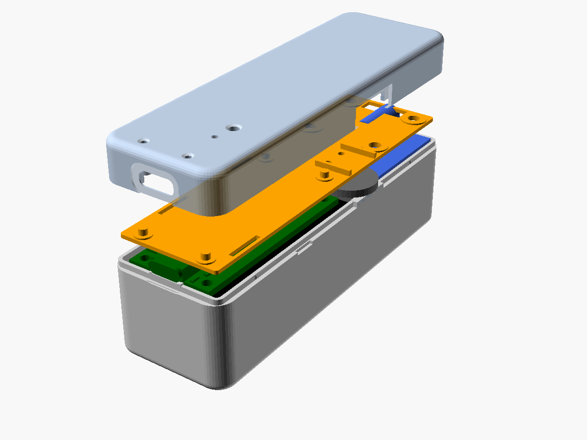

# OpenALD Feather RP2040 v1.0

This is a variant of the OpenALD pocket FM radio built around an **Adafruit Feather RP2040**. It has:
* an FM module (Victor's module: **27.25 × 27.25 mm, 1.6 mm board, Ø3.8 mm holes in the corners on a 20 mm square,
  a 4-pin 90° through-board header and a standard 6.35 × 14 mm headphone jack, both centred on the bottom edge, the
  jack 1 mm past the board**),
* an 18650 cell in an MPD BH-18650-PC holder (the same holder as the single-board radio),
* a **Mitsumi SIQ-02FVS3 thumbwheel** (volume/tune + push) glued into a printed cradle on the deck,
* an **SS-12F16 slide switch** (SPDT, "G4" 4 mm knob by default) pressed into a groove in the case wall, no screws,
* a **USB-C receptacle breakout** as the dock charging port (the Feather's own USB-C is now for programming only),
* hand-soldered wires to the Feather. **There is no custom PCB** in this variant.

**2026-11-24 unified envelope (still v1.0):** the case now has the **same length, thickness, edge radius and dock
USB-C position as the MI03 and single-board radios** (89.75 L × 34.83 T, USB-C on the left long side, centred 30.3 mm
from the top outer end and 7.55 mm behind the front face, mouth 1.0 mm inside the side face), so all three use the
same charging-dock pocket (they dock **lying on that side**, see `../charging_dock/DOCK_INTERFACE.md`). It is
**32.9 mm wide** instead of 27.5: the 27.25 mm FM module has to fit across the inside, and that is the smallest width
that holds it with 2 mm walls. Width is free in the dock (it is the height above the pocket floor).

> **Status: design only. Nothing here has been printed, built or tested.**
> - FM module: outline, holes, jack and header from Victor's description; the header pin length/side, the jack
>   barrel diameter at the end wall and the module pin order are **assumed** (see "Measure and edit").
> - The USB-C charge-port breakout is a **generic assumed part** (12.7 × 10 × 1.0 mm board, receptacle on its edge,
>   overhanging 0.5 mm, 5.1 k CC pull-downs on board). Measure yours.
> - Feather part heights are datasheet estimates; board outline, holes, LEDs, buttons, pads and connectors come from
>   Adafruit's own Eagle file. Wheel and switch geometry come from their datasheets, not from measured parts.

## Folder contents
| Path | What |
|---|---|
| `case/` | OpenSCAD source (`openald_feather_case.scad`), generated `case_params.scad` / `feather_params.scad`, print-ready **`case_top.stl`** (front shell), **`case_bottom.stl`** (back shell), **`deck.stl`** (inner plate), `case_fit_report.txt`, `build_case.sh` |
| `previews/` | `case_exploded.png`, `case_closed.png`, `case_closed_back.png`, `case_print_layout.png`, `front_face.png`, close-ups (`closeup_dock_usb_c.png`, `closeup_jack_end_fm.png`, `closeup_top_end_feather_usb.png`, `closeup_wheel_switch.png`) and sections (`section_fm_y14.png`, `section_dock_usb_y57.png`, `section_switch_y70.png`) |
| `docs/` | `wiring_diagram.svg/.png`, `wiring_schematic/` (KiCad 9 schematic + PDF), `pin_map.md`, `firmware_notes.md`, `BOM.md/.csv` |
| `firmware/` | **Arduino firmware** `openald_feather/` (arduino-pico core), `build.sh` (arduino-cli), prebuilt `openald_feather_v1.0.uf2`. Compiles; **not tested on hardware** |
| `scripts/` | `layout.py` (single source of truth for the mechanical layout), `feather_data.py`, `gen_case_params.py`, `check_fit.py`, `make_wiring.py`, `make_schematic.py` (+ `sexp.py`, `symlib.py`) |
| `ref/` | Adafruit Feather RP2040 Eagle board (CC BY-SA), the parsed mechanical data, and `models/SIQ-02FVS3.wrl` |
| `archive/controls_board_pcb/` | The **retired** controls PCB from before the direct-mount change. Not used, not maintained |
| `make_all.sh` | Rebuilds everything: Feather data → wiring diagram + schematic (ERC) → case params → STLs → fit check → renders |

The charging-dock check for all three radios (this one included) is `../charging_dock/scripts/check_dock_fit.py`
(run by the dock's `build_case.sh`); the old `scripts/check_dock.py` (which compared against the single-board case's
bottom 52 mm) is gone with the old upright dock.

## Firmware and wiring (added 2026-11-12)
* **Wiring:** [`docs/wiring_diagram.png`](docs/wiring_diagram.png) (and `.svg`) shows every hand-soldered wire; [`docs/wiring_schematic/openald-feather-wiring.pdf`](docs/wiring_schematic/openald-feather-wiring.pdf) is the same circuit as a KiCad 9 schematic (ERC 0 errors / 0 warnings); the pin table is in [`docs/pin_map.md`](docs/pin_map.md).
* **Firmware:** [`firmware/openald_feather/`](firmware/openald_feather/) is an Arduino sketch for Earle Philhower's arduino-pico core (board "Adafruit Feather RP2040") plus the Adafruit NeoPixel library. `firmware/build.sh` compiles it with arduino-cli; `firmware/openald_feather_v1.0.uf2` is a prebuilt image (double-tap RESET through the pin-hole, copy the .uf2 to the RPI-RP2 drive). **It compiles; it has not been run on hardware.**
* **Wheel:** turn = volume (0 mutes, 1–15), short press = battery level on the NeoPixel for 3 s, hold ≥ 0.5 s without turning = seek up, push and turn = tune (200 kHz per detent by default). The last frequency and volume are saved to flash 5 s after the last change; the first boot after flashing starts at **97.3 MHz** (the settings format was bumped on 2026-11-14 so a station saved by an older build is ignored once). At power-on the battery level is shown for **5 s**, then the NeoPixel turns off.
* **Battery level colours** (NeoPixel, 50 mV hysteresis, same thresholds as the single board's 3-LED bar): green ≥ 3.90 V, yellow 3.60–3.90, orange 3.40–3.60, red slow blink 3.30–3.40, red fast blink < 3.30. Below 3.25 V the radio is powered down (it restarts above 3.45 V). The NeoPixel is **off at all other times** (no seek, error or low-battery blinks) to save battery. Its power can't be cut: on the Feather RP2040 the WS2812B's VDD is wired straight to 3.3 V and there is no NeoPixel power pin (GPIO 20 is MISO on this board), so a dark pixel still draws its idle current (~1 mA typ., datasheet value, not measured) while the switch is ON. Seek and "FM module not found" are reported only on the USB serial log.
* **Differences from the single board:** no wheel-press battery check with the switch OFF (EN holds the Feather's regulator off, so nothing can run); the level is a NeoPixel colour, not a 3-LED bar, and the NeoPixel is hidden while docked; the firmware cannot see the charge state (STAT only drives the optional LEDs).

## Size, layout and the dock interface (2026-11-24)
Case frame: X across (0 = centre, −X = dock side), Y along (0 = inside of the jack-end wall, top end at +Y),
Z from the back face (0) to the front face (34.83).

| | Value |
|---|---|
| Outside | **32.90 W × 89.75 L × 34.83 T**, plan corners r 5, edges r 2 (was 45.5 × 92.0 × 33.41) |
| Walls / floor / front | 2.0 / 1.4 / 1.6 |
| Parts | **back shell** (Z 0 – 23.01 + 1.4 lip), **deck** (Z 23.01 – 24.01, separate plate), **front shell** (Z 24.01 – 34.83) |
| Dock USB-C (breakout) | centre 30.30 from the top outer end, 7.55 behind the front face, mouth 1.00 inside the left face — **identical to the MI03 and the single board** (fit report: "dock interface: MATCH") |

**Back shell (Z 0 – 23):** the **18650 holder** lies on the floor against the right wall and the top end
(X −6.75…14.15, Y 7.55…85.25, in a 0.3 mm floor pocket). The **Feather stands on its long edge** against the left wall
(components toward the wall, its back face 0.3 mm from the holder), its lower edge in a 0.5 mm floor groove, between
three locating ribs; its **USB-C faces the top end wall** and is reached through an opening there (programming /
firmware only). Its on-board LEDs and NeoPixel face the wall and are hidden.

**Deck (Z 23.01 – 24.01):** rests on ledges along the jack end and both long walls and lies 0.6 mm over the cell;
front-shell posts clamp it. It carries:
* the **FM module** at the jack end, centred (X ±13.625, Y 1.0 – 28.25), on four 0.4 mm standoffs at its holes,
  jack toward the jack-end wall; the jack barrel ends 1 mm past the board, and the end wall has a **6.8 mm plug hole**
  on the jack axis (Z 29.19). The 4-pin header points **down** through a window in the deck (pins assumed
  8.5 mm long below the board; nothing is under it: the holder starts at Y 7.55). **Mounting:** four front-shell
  posts (Ø6, Ø3.4 clearance holes) press the module's corners onto the standoffs when the case closes; optionally
  M3 × 8 screws through the module and the deck (Ø3.3 holes) with nuts underneath at the three corners that are not
  over the holder.
* the **USB-C breakout** (dock charging port) on the left wall at Y 57.45, receptacle 7.55 behind the front face,
  held between a deck block and two front-shell posts, receptacle mouth 1.0 inside the face, cable-plug recess
  13.0 × 7.6 r 3 in the wall (MI03 geometry).
* the **thumbwheel cradle** (right wall, dial centre Y 41), dial **0.95 mm proud** of the right face through a slot
  that runs down to the split (a back-shell tab fills it under the dial).

**Front shell (Z 24.01 – 34.83):** the **SS-12F16 switch** in a groove inside the right wall at Y 70 (plate behind a
1.2 mm skin, knob slot 6.6 × 3.6, G4 knob 2.8 mm proud, ON toward the top end), the two optional **3 mm charge LEDs**
in the front face at (3.0, 80.5) red/CHG and (3.0, 75.0) green/FULL, the clamp posts, and the snap lip
(bumps at Y 12 and 75 on the left, 12 and 55 on the right; gaps at the breakout and the switch).

**Docked:** the radio lies on its left face, front face toward you, top end left; the switch knob and wheel point up.
Plug insertion 6.0 mm past the breakout's receptacle mouth (same as the other two radios).

### Dock charging wiring (new)
| From | To | Note |
|---|---|---|
| Breakout **VBUS** | Feather **USB** pin through a **Schottky diode** (e.g. SS14 / 1N5817, anode at the breakout) | Charges through the Feather's own charger (200 mA). The diode stops the breakout and the Feather's own USB-C from back-feeding each other if both are plugged in. |
| Breakout **GND** | Feather **GND** splice | |
| Breakout CC1/CC2 | 5.1 k to GND on the breakout | Required: without them a USB-C charger supplies nothing. Pick a breakout that has them. |

**Not yet in `docs/wiring_diagram.*` / `docs/wiring_schematic/`** (those still show the 2026-11-12 wiring without the
breakout); the table above and `docs/pin_map.md` are current.

## Print and assemble
1. Print `case/case_bottom.stl` (back face down), `case/case_top.stl` (front face down) and `case/deck.stl` (flat,
   top face down). PLA or PETG, 0.2 mm layers; the FM plug hole and the two USB-C openings bridge ≤ 9 mm.
2. Back shell: glue/tape the holder into its floor pocket (+ end toward the top end). Wire the Feather (wheel, switch,
   divider, FM header, breakout, battery lead) per `docs/pin_map.md`, then stand it in the left-wall groove, USB-C to
   the top-end opening.
3. Deck: glue the wheel into the cradle, set the breakout into its slot, put the FM module on its standoffs (header
   pins down through the window, wires soldered underneath), lay the deck onto its ledges.
4. Front shell: press the switch plate into the right-wall groove from inside, then lower the front shell straight
   onto the back shell until the four snaps click. The posts clamp the deck, the FM module and the breakout.

## Measure and edit (all in `scripts/layout.py`, then `case/build_case.sh`)
* FM module: `FM_S`, `FM_HOLE_PITCH`, `FM_JACK_D/L/OUT`, header `FM_HDR` (pin side and length), standoff height.
* Breakout: `BRK_W`, `BRK_D`, `BRK_T`, `BRK_PARTS_H` and where its receptacle sits on it.
* Feather: run `python3 scripts/feather_data.py --usb-overhang <mm>` for older boards.

## Checks (`case/build_case.sh` → `case/case_fit_report.txt`)
* All three printed parts watertight, one body each; **0 interferences** between them and the ghost parts (holder,
  Feather + parts, FM module + jack + header, breakout, wheel, switch in both positions, LEDs); assembly path (front
  shell lowered straight down past the breakout, wheel and FM module) clear.
* Dock interface: 32.90 × 89.75 × 34.83, USB-C 30.30 / 7.55 / 1.00 → **MATCH**. Dock insertion is checked with the
  real STLs in `../charging_dock/case/dock_fit_report.txt` (0 interferences in all six pockets).

## Known risks and limits
* Nothing has been printed or built. Fit is CAD-only, from datasheet dimensions and Victor's FM-module description.
* **Wider than the other two** (32.9 vs 27.5 mm): needed for the 27.25 mm module plus walls. Same dock pocket.
* **The Feather's NeoPixel and red LED now face the wall and cannot be seen.** The firmware's battery-level colour is
  therefore invisible; only the two optional 3 mm front LEDs (charge state) show. Open decision: move the battery
  display to a front LED (firmware change) or accept it.
* The Feather's own USB-C is reachable at the top end for programming, but do not plug it and the dock in at the same
  time without the Schottky diode in the breakout's VBUS line.
* FM module header: assumed straight pins pointing down; if yours is a right-angle header with pins lying along the
  board, bend or replace it so the pins go down through the deck window.
* Charging is slow: 200 mA (the Feather's charger), about 18 h for 3500 mAh. Off-state drain about 0.4 mA through the
  Feather's EN pull-up.
* The wheel has no RC debounce or ESD diode; the firmware debounces it.
* Battery change: open the snaps, lift the deck (with the wheel, FM module and breakout wired to the Feather) and the
  Feather out together. Not tool-free.

Licence: case and scripts are released into the public domain under CC0 1.0, like the rest of OpenALD (see `../LICENSE`). The Adafruit Feather RP2040 Eagle file in `ref/` (and the mechanical data parsed from it) is CC BY-SA (Adafruit).
